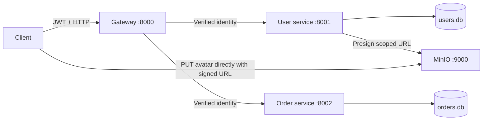

# BTNV-KTPM — User, Order and API Gateway

This project implements the assignment with two independently running FastAPI
services, an API Gateway, SQLite storage, and MinIO for direct avatar uploads.
The gateway is implemented in Python; nginx is an example in the assignment,
not a requirement.



## Run with Docker

1. Copy `.env.example` to `.env` if you do not already have one.
2. Set `SECRET_KEY` and `GATEWAY_SECRET` to different random secrets. Generate
   each with `python3 -c "import secrets; print(secrets.token_hex(32))"`.
   All settings listed in `.env.example` are required; application configuration
   has no fallback values. Keep existing values when adding missing entries.
3. Start everything:

```bash
docker compose up --build -d
```

The first build compiles MinIO from its pinned upstream source release because
MinIO Community is now source-only. See the [upstream release instructions](https://github.com/minio/minio/releases/tag/RELEASE.2025-10-15T17-29-55Z).

| Component | Local address |
|---|---|
| API Gateway | http://127.0.0.1:8000 |
| User service Swagger docs | http://127.0.0.1:8001/docs |
| Order service Swagger docs | http://127.0.0.1:8002/docs |
| MinIO S3 API | http://127.0.0.1:9000 |
| MinIO console | http://127.0.0.1:9001 |

MinIO credentials come from `MINIO_ACCESS_KEY` and `MINIO_SECRET_KEY` in `.env`
(the example uses `minioadmin` for local development). The private avatar bucket
is created automatically on the first upload URL request. Database files and
objects persist in separate named Docker volumes. `docker compose down` stops
the stack and preserves these volumes.

## Run Python services locally

Install dependencies with `uv sync --frozen`, configure `.env`, and run each
command in a separate terminal from the repository root:

```bash
uv run uvicorn src.services.users:app --host 127.0.0.1 --port 8001 --no-proxy-headers
uv run uvicorn src.services.orders:app --host 127.0.0.1 --port 8002 --no-proxy-headers
uv run uvicorn src.main:app --host 127.0.0.1 --port 8000 --workers 1 --no-proxy-headers
```

Run MinIO separately with `docker compose up --build -d minio`. By default the
local User service uses `btvn_ktpm.db`, and the Order service uses `orders.db`.
`DATABASE_URL` and `ORDER_DATABASE_URL` can change those locations. They must
point to different databases. Each service creates only its own tables. There
are no cross-service SQL foreign keys or joins: ownership comes from the
verified user identity. Existing data from an earlier shared database is not
migrated automatically.

The default `src.main:app` and `btvn_ktpm` command now start the gateway.
The old `/api/auth` and `/api/orders` paths are replaced by `/users` and `/orders`.

## API workflow

Register and log in through the gateway (these two POST endpoints are public):

```bash
curl -sS http://127.0.0.1:8000/users/register \
  -H 'Content-Type: application/json' \
  -d '{"username":"alice","password":"secret123","name":"Alice"}'
curl -sS http://127.0.0.1:8000/users/login \
  -H 'Content-Type: application/json' \
  -d '{"username":"alice","password":"secret123"}'
```

Copy the returned `access_token` into `TOKEN`. Use it on protected requests:

```bash
TOKEN='paste-access-token-here'
curl -sS http://127.0.0.1:8000/users/me -H "Authorization: Bearer $TOKEN"
curl -sS http://127.0.0.1:8000/orders \
  -H "Authorization: Bearer $TOKEN" -H 'Content-Type: application/json' \
  -d '{"total_amount":"49.90"}'
curl -sS http://127.0.0.1:8000/orders -H "Authorization: Bearer $TOKEN"
curl -sS http://127.0.0.1:8000/dashboard -H "Authorization: Bearer $TOKEN"
```

| Endpoint | Behavior |
|---|---|
| `POST /users/register` | Register a customer; duplicate usernames return 409 |
| `POST /users/login` | Return a signed JWT and user profile |
| `GET /users` or `/users/me` | Current user's profile |
| `POST /users/logout` | Return 204; the client discards its stateless JWT |
| `POST /orders` | Create a pending order owned by the signed-in user |
| `GET /orders` | List own orders; admins can list all orders |
| `GET /orders?mine=true` | List only the signed-in user's orders, including for admins |
| `GET /orders/{id}` | Get an owned order; admins can access any order |
| `DELETE /orders/{id}` | Delete an owned pending order; admins can delete any order |
| `GET /dashboard` | Fetch profile and own orders concurrently and combine them |
| `POST /users/me/avatar/upload-url` | Issue a scoped MinIO PUT URL valid for 300 seconds |
| `GET /users/me/avatar` | Issue a 300-second download URL for the uploaded avatar |
| `GET /health` | Component health |

JWTs require a valid signature, expiration, UUID subject, issue time and role.
The gateway validates the JWT, strips client-supplied identity headers, and
forwards identity with `GATEWAY_SECRET`. Downstream services trust identity only
with this separate secret. Direct service calls still require a valid JWT;
these authenticated calls are also used by the latency benchmark.

The gateway allows **10 requests in any rolling one-second window per client IP**.
Request 11 returns **429** with `Retry-After`. Rejected authentication attempts
also count. Root, health and documentation endpoints are exempt. Do not run
multiple gateway workers: the limiter is in memory, per process. Socket client
IP is used; forwarded IP headers are not trusted. Upstream connection failures
return 502; timeouts return 504.

## Avatar upload (Valet Key)

```bash
curl -sS http://127.0.0.1:8000/users/me/avatar/upload-url \
  -H "Authorization: Bearer $TOKEN" -H 'Content-Type: application/json' \
  -d '{"content_type":"image/png"}'
```

The response includes `upload_url`, `method: PUT`, `expires_in: 300`, the required
content type header, and `object_key: avatars/<current-user-id>/avatar`. Send the
file directly to that returned URL, without the application JWT:

```bash
UPLOAD_URL='paste-the-returned-upload-url-here'
curl --fail-with-body -X PUT "$UPLOAD_URL" \
  -H 'Content-Type: image/png' --data-binary @avatar.png
curl -sS http://127.0.0.1:8000/users/me/avatar -H "Authorization: Bearer $TOKEN"
```

URLs permit access to one user's avatar object for five minutes. Uploading
again replaces that user's avatar. The API accepts PNG, JPEG or WebP content
type requests; the direct PUT URL does not inspect file bytes. Objects remain
private, and no MinIO secret is sent to the uploader. `MINIO_PUBLIC_ENDPOINT`
must be the exact host reachable by the uploader, since changing a hostname
after signing invalidates the URL. The Compose configuration uses internal
`minio:9000` for storage operations and `127.0.0.1:9000` for client-facing URLs.

## Verification and latency measurement

```bash
uv run python -m unittest discover -s tests -v
uv run python scripts/smoke.py
uv run python scripts/benchmark.py --requests 100
```

The automated tests run in-process against isolated temporary SQLite files.
They cover routing, JWT rejection, spoofed identity headers, order ownership,
admin dashboard filtering, rate limits, avatar URL scope/TTL, request validation,
and upstream failures. The smoke script requires the running stack and verifies
an actual MinIO upload/download, signature scope and expired URL rejection.

The benchmark compares the same authenticated `/users/me` call directly against
the User service and through the gateway. It alternates measurement order, warms
connections, respects the rate limit and aborts on failed requests. It writes
raw samples and mean/median/p95 latency to `reports/latency.json` and
`reports/latency.md`. Measurements depend on local machine load.

Recorded verification results are in [the assignment checklist](reports/requirements.md),
[the live smoke results](reports/smoke.json), and [the latency report](reports/latency.md).
The recorded run used separate local processes; the complete Docker stack has
not been verified under this machine's 2 GB Docker memory limit.
